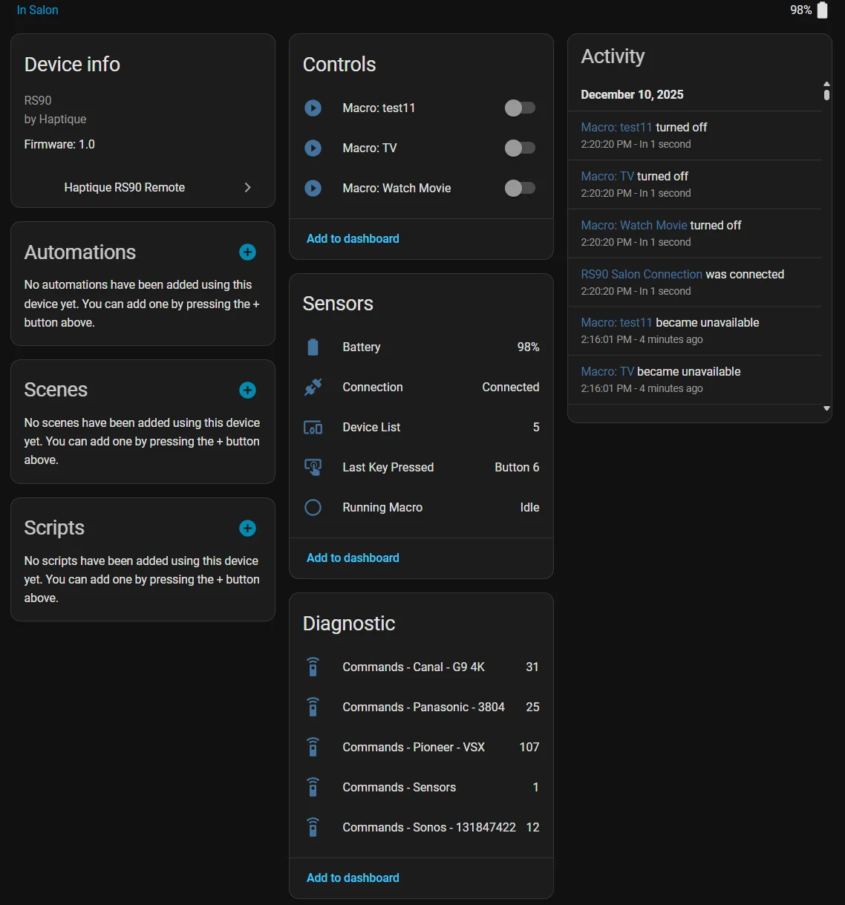
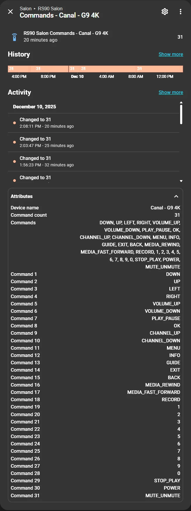

# Haptique RS90 - Home Assistant Integration

## Standard MQTT contribution (draft)

Adds real-macro and sequence switches, persisted-state queries and fresh discovery
requests. Existing registered macro switches are preserved during sequence migration.
State remains unknown until firmware feedback arrives; execution requests are never
retained. See [Standard MQTT controls and acceptance](documentation/STANDARD_MQTT.md)
for actions, firmware compatibility and the outstanding live-device checks.


[](https://github.com/daangel27/haptique_rs90/releases)
[](https://github.com/hacs/integration)
[](LICENSE)

Home Assistant integration for the **Haptique RS90** universal remote via MQTT.

**English** | [Français](README_FR.md)

---

## 📸 Screenshots

<table>
<tr>
<td width="30%">

<p align="center"><em>Device Information & Controls</em></p>
</td>
<td width="30%">

<p align="center"><em>Device List</em></p>
</td>
<td width="50%">

<p align="center"><em>Device Commands List</em></p>
</td>
</tr>
</table>

---

## ✨ Features

### Core Features
- 🎛️ **Macro switches**: Control your macros with visible ON/OFF state
- 📋 **Battery sensor**: Monitor remote battery level with optimized refresh
- 📌 **Connection status**: Real-time online/offline detection
- 🎮 **Key detection**: Event-based button press detection (every press triggers)
- 🎯 **Device triggers**: Native Home Assistant automation UI support (24 buttons)
- 🔄 **RGB Ring Light**: Button and service to trigger animation

### Advanced Features
- 📱 **Device list**: View all configured devices with command sensors
- 📊 **Info Summary sensor**: All IDs in one place for easy service calls
- 🔄 **100% MQTT-driven**: No polling, pure event-driven updates
- 🎯 **QoS optimized**: QoS 0 for monitoring, QoS 1 for control commands
- 🚀 **Auto-discovery**: Automatic Remote ID detection
- 🌐 **Multi-language**: English and French

### What's New in v1.7.0
- ⚡ **Event-based key press**: Every button press fires an event (including repeated presses)
- 🎮 **Device triggers**: 24 buttons available in automation UI (no YAML needed)
- 🔄 **Macro status sync**: Accurate macro state when triggered from RS90 remote (requires firmware update)
- 🔋 **Smart battery refresh**: Automatic refresh on reconnection + throttle protection
- 📍 **MQTT RemoteID exposed**: Easy access for debugging

---

## 📋 Requirements

- Home Assistant 2024.1.0 or higher
- **Configured MQTT broker** (Mosquitto recommended)
- **Haptique RS90 remote configured and connected to MQTT**
- **RS90 Firmware**: Latest version recommended for all features
  - Macro status sync requires upcoming firmware update (contact Haptique support)

---

## 🚀 Installation

### Via HACS (Recommended)

[](https://my.home-assistant.io/redirect/hacs_repository/?owner=daangel27&repository=haptique_rs90&category=integration)

**Manual steps** (if the button doesn't work):

1. Open **HACS** in Home Assistant
2. Click **Integrations**
3. Click **⋮** (three dots) → **Custom repositories**
4. Add repository:
   - **URL**: `https://github.com/daangel27/haptique_rs90`
   - **Category**: `Integration`
5. Click **Add**
6. Search for **"Haptique RS90"**
7. Click **Download**
8. Restart Home Assistant

### Manual Installation

1. Download the [latest release](https://github.com/daangel27/haptique_rs90/releases)
2. Extract to `/config/custom_components/haptique_rs90/`
3. Restart Home Assistant

---

## ⚙️ Configuration

### Prerequisites

Before adding the integration, make sure:
1. ✅ **MQTT broker is configured** in Home Assistant
2. ✅ **RS90 is configured** to connect to your MQTT broker (via Haptique Config app)
3. ✅ **RS90 is online** and publishing to MQTT

### Quick Setup

1. Go to **Settings** → **Devices & Services**
2. Click **Add Integration**
3. Search for **Haptique RS90**
4. **The integration will automatically discover your remote** 🎉
5. Give it a name (optional, default: "RS90 {ID}")
6. Click **Submit**

That's it! All entities are created automatically.

---

## 📊 Created Entities

### Sensors

| Entity | Description | Update Frequency |
|--------|-------------|------------------|
| `sensor.rs90_battery` | Battery level (0-100%) | Every 30 min + on reconnection |
| `sensor.rs90_info_summary` | All IDs in one place | Static |

### Binary Sensors

| Entity | Description | States |
|--------|-------------|-------|
| `binary_sensor.rs90_connection` | Connection status | ON (online) / OFF (offline) |
| `binary_sensor.rs90_last_key_pressed` | Last pressed key | Button number |

### Switches

| Entity | Description | Actions |
|--------|-------------|---------|
| `switch.macro_{name}` | Macro control | ON / OFF / TOGGLE |

**Features:**
- ✅ Visible state (ON = active, OFF = inactive)
- ✅ State syncs when triggered from RS90 remote (with firmware update)
- ✅ Dynamic icon (▶️ / ⏹️)

### Buttons

| Entity | Description | Action |
|--------|-------------|--------|
| `button.rgb_ring_light` | RGB animation trigger | Activate 5 seconds |

---

## 🎯 New in v1.7.0: Event-Based Automations

### Using Events (Advanced)

Every button press fires an event:

```yaml
automation:
  - alias: "Button 13 - Toggle lights"
    trigger:
      - platform: event
        event_type: haptique_rs90_key_pressed
        event_data:
          button: 13
    action:
      - service: light.toggle
        target:
          entity_id: light.living_room
```

**Event data includes:**
- `remote_id`: MQTT RemoteID
- `device_id`: Home Assistant Device ID
- `button`: Button number (1-24)
- `timestamp`: Press timestamp

### Using Device Triggers (Easy - UI Only)

**No YAML needed!** Create automations directly in the UI:

1. **Add Automation** → **Add Trigger** → **Device**
2. Select **RS90 Remote**
3. Choose **Button pressed**
4. Select button number (1-24)
5. Add actions
6. Save

**Generated YAML:**
```yaml
trigger:
  - platform: device
    device_id: [your_rs90_id]
    domain: haptique_rs90
    type: button_pressed
    button: 13
```

**Benefits:**
- ✅ Fires on every press (including repeated presses)
- ✅ Works simultaneously with RS90 macros
- ✅ Visual automation builder compatible

---

## 🔧 Available Services

### `haptique_rs90.trigger_macro`

Trigger a macro on/off.

```yaml
service: haptique_rs90.trigger_macro
data:
  rs90_id: "9b974dab9a7649e13baeb921d4c9bb85"  # From device page or Info Summary
  rs90_macro_id: "692eb1561bddd5814022960c"     # From switch attributes or Info Summary
  action: "on"
```

**Find IDs:**
- `rs90_id`: Device page URL or `sensor.rs90_info_summary` attribute
- `rs90_macro_id`: `switch.macro_{name}` attributes or Info Summary

### `haptique_rs90.trigger_device_command`

Send a command to a device.

```yaml
service: haptique_rs90.trigger_device_command
data:
  rs90_id: "9b974dab9a7649e13baeb921d4c9bb85"
  rs90_device_id: "692ead781bddd58140228e33"  # From sensor attributes or Info Summary
  command_name: "POWER"
```

### `haptique_rs90.refresh_lists`

Force refresh of devices, macros, and battery.

```yaml
service: haptique_rs90.refresh_lists
data:
  rs90_id: "9b974dab9a7649e13baeb921d4c9bb85"
```

### `haptique_rs90.trigger_rgb_light`

Trigger RGB ring light animation.

```yaml
service: haptique_rs90.trigger_rgb_light
data:
  rs90_id: "9b974dab9a7649e13baeb921d4c9bb85"
  duration: 5  # 1-10 seconds
```

---

## 🛠️ Troubleshooting

### Remote not detected

1. Verify **MQTT broker is configured** (Settings > Devices & Services > MQTT)
2. Check **RS90 is configured** to connect to MQTT (Haptique Config app)
3. Verify **RS90 is online** (check in Haptique Config app)
4. Enable debug logs:

```yaml
logger:
  logs:
    custom_components.haptique_rs90: debug
```

### Macro switches don't reflect correct state

**If using firmware without `/status` topic:**
- Macro state only updates when triggered via Home Assistant
- Triggering from RS90 remote won't sync state
- **Solution:** Update RS90 firmware when available (contact Haptique support)

**If using updated firmware:**
- Check MQTT Explorer for `macro/{name}/status` topics
- Verify topic publishes "ON"/"OFF" (uppercase)

### Battery shows 0 or outdated

Battery refreshes:
- Every 30 minutes (periodic)
- On RS90 reconnection (wake from sleep)
- Via `refresh_lists` service (manual)

If RS90 is frequently disconnecting (<5 min), refresh is throttled to once per 5 minutes.

---

## 📚 Documentation

- **[CHANGELOG.md](CHANGELOG.md)** - Version history and changes
- **[SETUP_GUIDE.md](SETUP_GUIDE.md)** - Detailed setup instructions
- **[Templates](templates/)** - Dashboard card templates

---

## 🤝 Contributing

Contributions are welcome!

1. Fork the project
2. Create a branch (`git checkout -b feature/improvement`)
3. Commit changes (`git commit -m 'Add feature'`)
4. Push (`git push origin feature/improvement`)
5. Open a Pull Request

---

## 📄 License

This project is licensed under the MIT License. See [LICENSE](LICENSE) file for details.

---

## 🙏 Acknowledgments

- [Cantata Communication Solutions](https://github.com/Cantata-Communication-Solutions) for creating the **Haptique RS90** remote
- **Haptique Support** for excellent collaboration on firmware features
- Home Assistant community for feedback and testing

---

## 📞 Support

- 🐛 [Report a bug](https://github.com/daangel27/haptique_rs90/issues)
- 💡 [Request a feature](https://github.com/daangel27/haptique_rs90/issues)
- 💬 [Discussions](https://github.com/daangel27/haptique_rs90/discussions)

---

**Version:** 1.7.0  
**Author:** daangel27  
**Last updated:** January 2026  
**Languages:** English, Français
