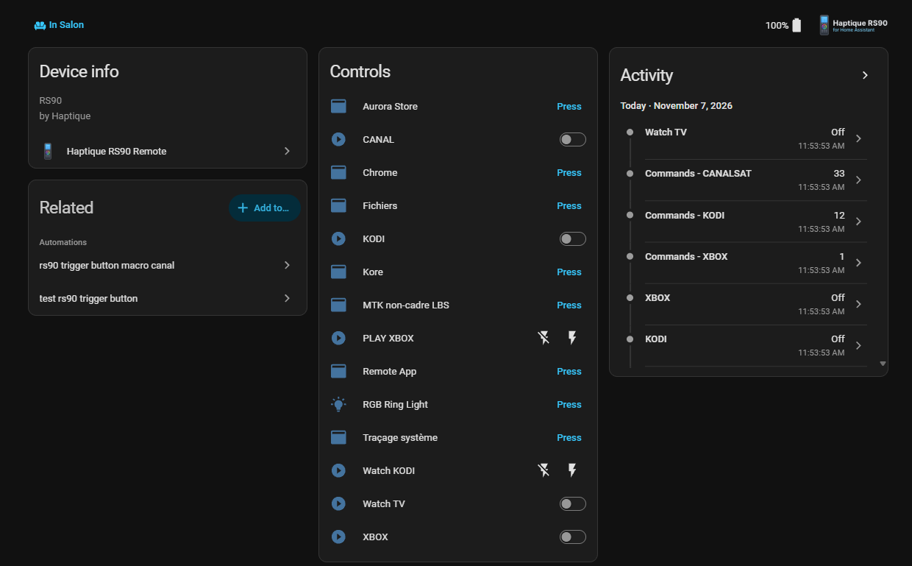
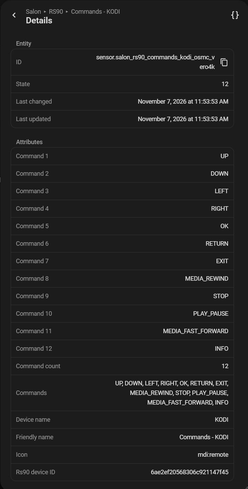

# Haptique RS90 - Home Assistant Integration

[](https://github.com/daangel27/haptique_rs90/releases)
[](https://github.com/hacs/integration)
[](LICENSE)

Home Assistant integration for the **Haptique RS90** universal remote via MQTT: macros, sequences, installed apps, device commands, key presses and RGB ring light.

**English** | [Français](README_FR.md)

---

## 📸 Screenshots

<table>
<tr>
<td width="30%">

<p align="center"><em>Device Information & Controls</em></p>
</td>
<td width="30%">

<p align="center"><em>Device List</em></p>
</td>
<td width="50%">

<p align="center"><em>Device Commands List</em></p>
</td>
</tr>
</table>

---

## ✨ Features

### Control
- 🎛️ **Macro and sequence switches**: ON/OFF from Home Assistant, state confirmed by the RS90 firmware
- 📱 **App buttons**: launch any app installed on the RS90 (disabled by default, enable the ones you want)
- 📡 **Device commands**: send any IR/IP command of any configured device
- 🌈 **RGB Ring Light**: button and action to trigger an animation

### Monitoring
- 📊 **Last Macro Result**: last execution result with macro name, action and status (e.g. `CANAL · OFF · skipped (already_in_requested_state)`), with one logbook entry per result
- 📲 **Last Reported App**: last app reported by the RS90, shown by name
- 🔋 **Battery** and 📌 **Connection** sensors
- 🎮 **Key presses**: an event on every press, plus native device triggers (24 buttons) for the automation editor

### Under the hood
- 🔄 **100% MQTT, event-driven**: no polling
- 🆔 **Stable IDs**: entities survive renames in the Haptique app
- 🚀 **Auto-discovery** of the remote
- 🌐 **English and French**

---

## 📋 Requirements

- **Home Assistant 2024.8** or newer (the integration icon needs **2026.3** or newer)
- **MQTT broker** configured in Home Assistant (Mosquitto recommended)
- **Haptique RS90** connected to that broker, with the **Standard MQTT firmware** (tested on **4.1.2** and **4.2**)

---

## 🚀 Installation

### Via HACS (Recommended)

[](https://my.home-assistant.io/redirect/hacs_repository/?owner=daangel27&repository=haptique_rs90&category=integration)

**Manual steps** (if the button doesn't work):

1. Open **HACS** in Home Assistant
2. Click **⋮** (three dots) → **Custom repositories**
3. Add repository:
   - **URL**: `https://github.com/daangel27/haptique_rs90`
   - **Category**: `Integration`
4. Search for **"Haptique RS90"** and click **Download**
5. Restart Home Assistant

### Manual Installation

1. Download the [latest release](https://github.com/daangel27/haptique_rs90/releases)
2. Copy `custom_components/haptique_rs90/` to `/config/custom_components/haptique_rs90/`
3. Restart Home Assistant

---

## ⚙️ Configuration

Before adding the integration, make sure:
1. ✅ The **MQTT broker** is configured in Home Assistant
2. ✅ The **RS90 is connected** to that broker (Haptique Config app)
3. ✅ The **RS90 is online** (on its dock, see [Sleep mode](#-sleep-mode))

Then:
1. Go to **Settings** → **Devices & Services** → **Add Integration**
2. Search for **Haptique RS90**
3. The integration **discovers your remote automatically** 🎉
4. Give it a name (optional) and click **Submit**

All entities are created automatically.

---

## 📊 Created Entities

| Entity | Description |
|--------|-------------|
| **Macro switches** (one per macro) | Turn a macro ON/OFF. State comes from the firmware (`ON` / `OFF` / unknown) |
| **Sequence switches** (one per sequence) | Run a sequence ON/OFF |
| **App buttons** (one per installed app) | Launch the app. **Disabled by default**: enable them in Settings → Entities |
| **RGB Ring Light** button | Trigger the ring light animation |
| **Last Macro Result** sensor | Last result, e.g. `CANAL · ON · executed`. Attributes: `target_name`, `target_id`, `target_kind`, `action`, `status`, `error`, `timestamp`. Restored after restart |
| **Last Reported App** sensor | Last app reported by the RS90 (name), package in `app_package_id` |
| **Battery** sensor | Battery level (%), refreshed every 30 min and on reconnection |
| **Connection** binary sensor | Online / offline |
| **Last Key Pressed** sensor | Last pressed button |
| **Commands - {device}** sensors | Number of commands, full list in attributes |
| **Info Summary** sensor | All IDs (devices, macros, sequences, apps) in one place |

> ℹ️ Macro states are what the RS90 reports, **not** a measurement of the TV or amplifier power.

---

## 🎯 Automations

### Key presses

Every button press fires `haptique_rs90_key_pressed` (data: `remote_id`, `device_id`, `button`, `timestamp`):

```yaml
triggers:
  - trigger: event
    event_type: haptique_rs90_key_pressed
    event_data:
      button: 13
actions:
  - action: light.toggle
    target:
      entity_id: light.living_room
```

No YAML needed with **device triggers**: **Add Trigger** → **Device** → your RS90 → **Button pressed** → button 1-24.

### Macro results

Every macro/sequence result fires `haptique_rs90_macro_result` (data: `device_id`, `remote_id`, `target_kind`, `target_id`, `target_name`, `action`, `status`, `error`, `timestamp`). Example: get notified when a macro was skipped or failed:

```yaml
triggers:
  - trigger: event
    event_type: haptique_rs90_macro_result
conditions:
  - condition: template
    value_template: "{{ trigger.event.data.status in ['skipped', 'failed', 'rejected'] }}"
actions:
  - action: notify.notify
    data:
      message: >
        RS90 {{ trigger.event.data.target_name }}
        {{ trigger.event.data.action | upper }}:
        {{ trigger.event.data.status }} {{ trigger.event.data.error or '' }}
```

---

## 🔧 Available Actions

`rs90_id` is the **Home Assistant device ID** of the RS90 (pick it with the device selector in the action editor). IDs of macros, sequences, devices and apps are in the entity attributes and in **Info Summary**.

| Action | Description |
|--------|-------------|
| `haptique_rs90.trigger_macro` | Turn a macro ON/OFF (`rs90_macro_id`, `action`) |
| `haptique_rs90.trigger_sequence` | Run a sequence ON/OFF (`rs90_sequence_id`, `action`) |
| `haptique_rs90.query_status` | Ask the RS90 for the current state of a macro or sequence, without running it |
| `haptique_rs90.trigger_device_command` | Send a device command (`rs90_device_id`, `command_name`) |
| `haptique_rs90.launch_app` | Launch an installed app (`app_package_id`) |
| `haptique_rs90.trigger_rgb_light` | Trigger the RGB ring light (`duration` 1-10 s) |
| `haptique_rs90.refresh_lists` | Refresh devices, macros, sequences, apps and battery |

```yaml
action: haptique_rs90.trigger_macro
data:
  rs90_id: 9b974dab9a7649e13baeb921d4c9bb85
  rs90_macro_id: 6ae380a69f93a9111666b754
  action: "on"
```

```yaml
action: haptique_rs90.launch_app
data:
  rs90_id: 9b974dab9a7649e13baeb921d4c9bb85
  app_package_id: org.xbmc.kore
```

More details: [Standard MQTT macros, sequences and apps](documentation/STANDARD_MQTT.md) · [Finding the device ID](documentation/GUIDE_DEVICE_ID.md)

---

## 😴 Sleep mode

Off its dock, the RS90 goes to sleep after a while and shows as **offline**: its entities become unavailable and MQTT commands can't reach it. Put it back on the dock or wake it up (touch the screen or press a key).

---

## 🛠️ Troubleshooting

### Remote not detected
1. Check the **MQTT broker** in Settings → Devices & Services → MQTT
2. Check the RS90 **MQTT settings** in the Haptique Config app
3. Check the RS90 is **online** (on its dock)
4. Enable debug logs:

```yaml
logger:
  logs:
    custom_components.haptique_rs90: debug
```

### Macro state looks wrong
Known firmware limitations (reported to Haptique):
- A macro started **from the RS90 screen** is not published over MQTT, so Home Assistant doesn't see it
- When switching from one macro to another, the previous one can stay **ON**; turning it off later returns `skipped (already_in_requested_state)`

Use **Last Macro Result** and the logbook to see what the RS90 actually did, and `haptique_rs90.query_status` to re-read a state.

### Last Reported App doesn't change when leaving an app
The firmware only reports the app that was opened, not when you leave it.

---

## 📚 Documentation

- **[CHANGELOG.md](CHANGELOG.md)** - Version history
- **[WHATS_NEW.md](WHATS_NEW.md)** - What's new in 1.8.0
- **[Standard MQTT](documentation/STANDARD_MQTT.md)** - Macros, sequences, apps and actions in detail
- **[Device ID guide](documentation/GUIDE_DEVICE_ID.md)** - Finding the RS90 device ID
- **[Templates](templates/)** - Dashboard card templates

---

## 🤝 Contributing

Contributions are welcome: fork the project, create a branch, and open a Pull Request.

---

## 📄 License

MIT License. See [LICENSE](LICENSE).

---

## 🙏 Acknowledgments

- [Cantata Communication Solutions](https://github.com/Cantata-Communication-Solutions) for the **Haptique RS90** remote, and **Haptique Support** for the collaboration on firmware features
- [@ccs777](https://github.com/ccs777) for the Standard MQTT macros, sequences and apps support (PR #38, #39)
- **[Claude](https://claude.ai)** (Anthropic), AI pair programmer on this project: code, tests, reviews, documentation and icon
- The Home Assistant community for feedback and testing

---

## 📞 Support

- 🐛 [Report a bug](https://github.com/daangel27/haptique_rs90/issues)
- 💡 [Request a feature](https://github.com/daangel27/haptique_rs90/issues)
- 💬 [Discussions](https://github.com/daangel27/haptique_rs90/discussions)

---

**Version:** 1.8.0
**Authors:** daangel27, with Claude (Anthropic)
**Last updated:** November 2026
**Languages:** English, Français
