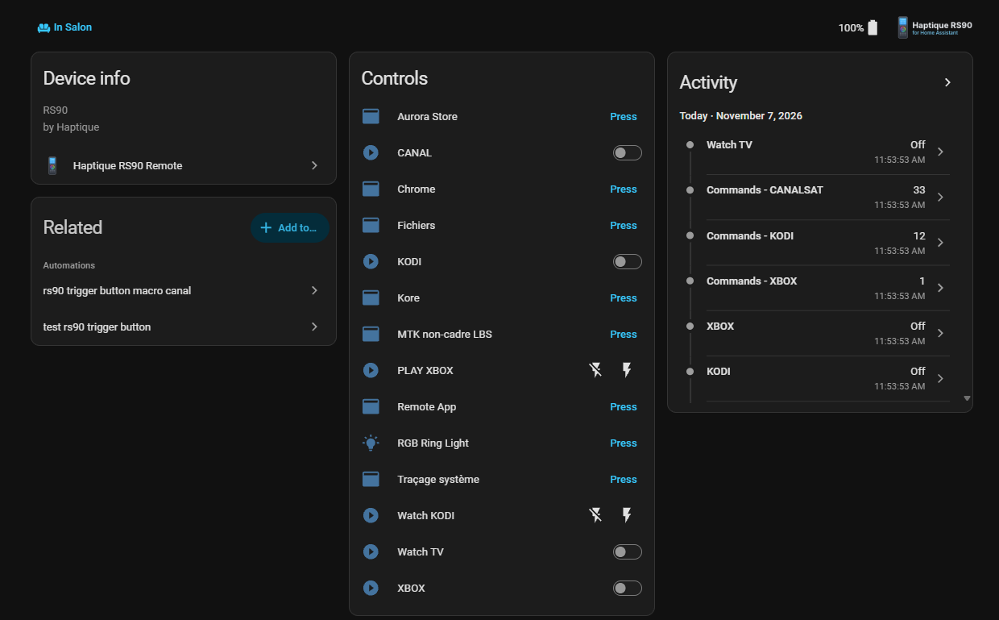
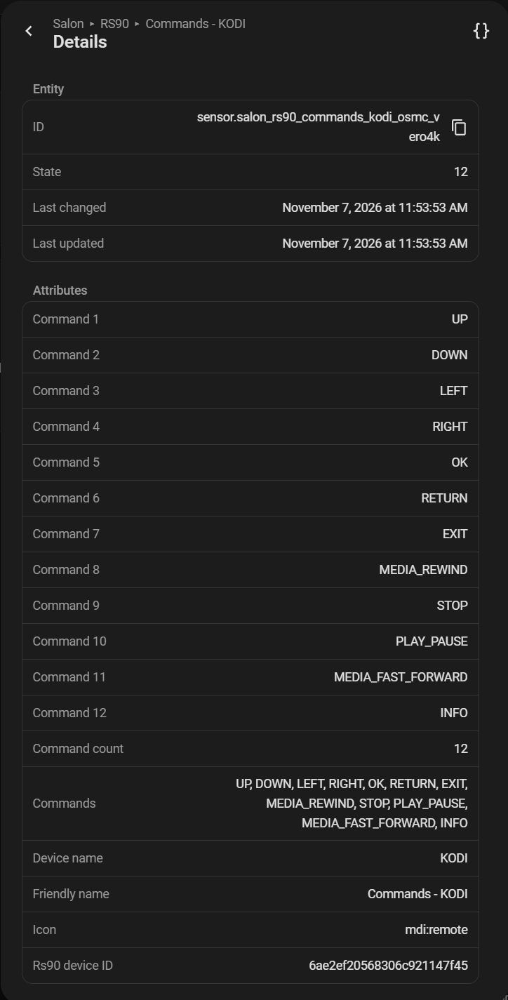

# Haptique RS90 - Intégration Home Assistant

[](https://github.com/daangel27/haptique_rs90/releases)
[](https://github.com/hacs/integration)
[](LICENSE)

Intégration Home Assistant pour la télécommande universelle **Haptique RS90** via MQTT : macros, séquences, applications installées, commandes des appareils, appuis de touches et anneau lumineux RGB.

[English](README.md) | **Français**

---

## 📸 Captures d'écran

<table>
<tr>
<td width="30%">

<p align="center"><em>Informations et contrôles de l'appareil</em></p>
</td>
<td width="30%">

<p align="center"><em>Liste des appareils</em></p>
</td>
<td width="50%">

<p align="center"><em>Liste des commandes d'un appareil</em></p>
</td>
</tr>
</table>

---

## ✨ Fonctionnalités

### Contrôle
- 🎛️ **Interrupteurs de macros et de séquences** : ON/OFF depuis Home Assistant, état confirmé par le firmware de la RS90
- 📱 **Boutons d'applications** : lancent n'importe quelle application installée sur la RS90 (désactivés par défaut, activez ceux qui vous intéressent)
- 📡 **Commandes des appareils** : envoient n'importe quelle commande IR/IP d'un appareil configuré
- 🌈 **Anneau lumineux RGB** : bouton et action pour déclencher une animation

### Suivi
- 📊 **Last Macro Result** : dernier résultat d'exécution avec le nom de la macro, l'action et le statut (ex. `CANAL · OFF · skipped (already_in_requested_state)`), avec une ligne dans le journal par résultat
- 📲 **Last Reported App** : dernière application signalée par la RS90, affichée par son nom
- 🔋 Capteurs de **batterie** et 📌 de **connexion**
- 🎮 **Appuis de touches** : un événement à chaque appui, et des déclencheurs d'appareil natifs (24 boutons) dans l'éditeur d'automatisations

### Sous le capot
- 🔄 **100 % MQTT, piloté par événements** : aucune interrogation périodique
- 🆔 **Identifiants stables** : les entités survivent aux renommages dans l'application Haptique
- 🚀 **Découverte automatique** de la télécommande
- 🌐 **Anglais et français**

---

## 📋 Prérequis

- **Home Assistant 2024.8** ou plus récent (l'icône de l'intégration nécessite **2026.3** ou plus récent)
- **Broker MQTT** configuré dans Home Assistant (Mosquitto recommandé)
- **Haptique RS90** connectée à ce broker, avec le **firmware Standard MQTT** (testé en **4.1.2** et **4.2**)

---

## 🚀 Installation

### Via HACS (recommandé)

[](https://my.home-assistant.io/redirect/hacs_repository/?owner=daangel27&repository=haptique_rs90&category=integration)

**Étapes manuelles** (si le bouton ne fonctionne pas) :

1. Ouvrez **HACS** dans Home Assistant
2. Cliquez sur **⋮** (trois points) → **Dépôts personnalisés**
3. Ajoutez le dépôt :
   - **URL** : `https://github.com/daangel27/haptique_rs90`
   - **Catégorie** : `Intégration`
4. Cherchez **« Haptique RS90 »** et cliquez sur **Télécharger**
5. Redémarrez Home Assistant

### Installation manuelle

1. Téléchargez la [dernière version](https://github.com/daangel27/haptique_rs90/releases)
2. Copiez `custom_components/haptique_rs90/` dans `/config/custom_components/haptique_rs90/`
3. Redémarrez Home Assistant

---

## ⚙️ Configuration

Avant d'ajouter l'intégration, vérifiez que :
1. ✅ Le **broker MQTT** est configuré dans Home Assistant
2. ✅ La **RS90 est connectée** à ce broker (application Haptique Config)
3. ✅ La **RS90 est en ligne** (sur son socle, voir [Mise en veille](#-mise-en-veille))

Ensuite :
1. Allez dans **Paramètres** → **Appareils et services** → **Ajouter une intégration**
2. Cherchez **Haptique RS90**
3. L'intégration **découvre automatiquement votre télécommande** 🎉
4. Donnez-lui un nom (facultatif) et cliquez sur **Valider**

Toutes les entités sont créées automatiquement.

---

## 📊 Entités créées

| Entité | Description |
|--------|-------------|
| **Interrupteurs de macros** (un par macro) | Allument/éteignent une macro. L'état vient du firmware (`ON` / `OFF` / inconnu) |
| **Interrupteurs de séquences** (un par séquence) | Lancent une séquence ON/OFF |
| **Boutons d'applications** (un par application installée) | Lancent l'application. **Désactivés par défaut** : activez-les dans Paramètres → Entités |
| Bouton **RGB Ring Light** | Déclenche l'animation de l'anneau lumineux |
| Capteur **Last Macro Result** | Dernier résultat, ex. `CANAL · ON · executed`. Attributs : `target_name`, `target_id`, `target_kind`, `action`, `status`, `error`, `timestamp`. Restauré après un redémarrage |
| Capteur **Last Reported App** | Dernière application signalée par la RS90 (nom), package dans `app_package_id` |
| Capteur **Battery** | Niveau de batterie (%), rafraîchi toutes les 30 min et à la reconnexion |
| Capteur binaire **Connection** | En ligne / hors ligne |
| Capteur **Last Key Pressed** | Dernière touche appuyée |
| Capteurs **Commands - {appareil}** | Nombre de commandes, liste complète en attributs |
| Capteur **Info Summary** | Tous les identifiants (appareils, macros, séquences, applications) au même endroit |

> ℹ️ L'état d'une macro est ce que la RS90 signale, **pas** une mesure de l'alimentation de la TV ou de l'ampli.

---

## 🎯 Automatisations

### Appuis de touches

Chaque appui déclenche `haptique_rs90_key_pressed` (données : `remote_id`, `device_id`, `button`, `timestamp`) :

```yaml
triggers:
  - trigger: event
    event_type: haptique_rs90_key_pressed
    event_data:
      button: 13
actions:
  - action: light.toggle
    target:
      entity_id: light.salon
```

Sans YAML avec les **déclencheurs d'appareil** : **Ajouter un déclencheur** → **Appareil** → votre RS90 → **Button pressed** → bouton 1 à 24.

### Résultats des macros

Chaque résultat de macro ou de séquence déclenche `haptique_rs90_macro_result` (données : `device_id`, `remote_id`, `target_kind`, `target_id`, `target_name`, `action`, `status`, `error`, `timestamp`). Exemple : être prévenu quand une macro a été ignorée ou a échoué :

```yaml
triggers:
  - trigger: event
    event_type: haptique_rs90_macro_result
conditions:
  - condition: template
    value_template: "{{ trigger.event.data.status in ['skipped', 'failed', 'rejected'] }}"
actions:
  - action: notify.notify
    data:
      message: >
        RS90 {{ trigger.event.data.target_name }}
        {{ trigger.event.data.action | upper }} :
        {{ trigger.event.data.status }} {{ trigger.event.data.error or '' }}
```

---

## 🔧 Actions disponibles

`rs90_id` est l'**identifiant d'appareil Home Assistant** de la RS90 (choisissez-le avec le sélecteur d'appareil dans l'éditeur d'actions). Les identifiants des macros, séquences, appareils et applications se trouvent dans les attributs des entités et dans **Info Summary**.

| Action | Description |
|--------|-------------|
| `haptique_rs90.trigger_macro` | Allume/éteint une macro (`rs90_macro_id`, `action`) |
| `haptique_rs90.trigger_sequence` | Lance une séquence ON/OFF (`rs90_sequence_id`, `action`) |
| `haptique_rs90.query_status` | Demande à la RS90 l'état actuel d'une macro ou d'une séquence, sans l'exécuter |
| `haptique_rs90.trigger_device_command` | Envoie une commande à un appareil (`rs90_device_id`, `command_name`) |
| `haptique_rs90.launch_app` | Lance une application installée (`app_package_id`) |
| `haptique_rs90.trigger_rgb_light` | Déclenche l'anneau lumineux RGB (`duration` 1 à 10 s) |
| `haptique_rs90.refresh_lists` | Rafraîchit les appareils, macros, séquences, applications et la batterie |

```yaml
action: haptique_rs90.trigger_macro
data:
  rs90_id: 9b974dab9a7649e13baeb921d4c9bb85
  rs90_macro_id: 6ae380a69f93a9111666b754
  action: "on"
```

```yaml
action: haptique_rs90.launch_app
data:
  rs90_id: 9b974dab9a7649e13baeb921d4c9bb85
  app_package_id: org.xbmc.kore
```

Plus de détails : [Macros, séquences et applications Standard MQTT](documentation/STANDARD_MQTT.md) (en anglais) · [Trouver l'identifiant de l'appareil](documentation/GUIDE_DEVICE_ID_FR.md)

---

## 😴 Mise en veille

Hors de son socle, la RS90 se met en veille au bout d'un moment et apparaît **hors ligne** : ses entités deviennent indisponibles et les commandes MQTT ne lui parviennent plus. Reposez-la sur son socle ou réveillez-la (touchez l'écran ou appuyez sur une touche).

---

## 🛠️ Dépannage

### Télécommande non détectée
1. Vérifiez le **broker MQTT** dans Paramètres → Appareils et services → MQTT
2. Vérifiez les **réglages MQTT** de la RS90 dans l'application Haptique Config
3. Vérifiez que la RS90 est **en ligne** (sur son socle)
4. Activez les logs de débogage :

```yaml
logger:
  logs:
    custom_components.haptique_rs90: debug
```

### L'état d'une macro semble faux
Limitations connues du firmware (signalées à Haptique) :
- Une macro lancée **depuis l'écran de la RS90** n'est pas publiée sur MQTT, Home Assistant ne la voit donc pas
- En passant d'une macro à une autre, la précédente peut rester **ON** ; l'éteindre ensuite renvoie `skipped (already_in_requested_state)`

Utilisez **Last Macro Result** et le journal pour voir ce que la RS90 a réellement fait, et `haptique_rs90.query_status` pour relire un état.

### Last Reported App ne change pas quand on quitte une application
Le firmware signale seulement l'application ouverte, pas le moment où on la quitte.

---

## 📚 Documentation

- **[CHANGELOG_FR.md](CHANGELOG_FR.md)** - Historique des versions
- **[WHATS_NEW_FR.md](WHATS_NEW_FR.md)** - Nouveautés de la 1.8.0
- **[Standard MQTT](documentation/STANDARD_MQTT.md)** - Macros, séquences, applications et actions en détail (en anglais)
- **[Guide de l'identifiant d'appareil](documentation/GUIDE_DEVICE_ID_FR.md)** - Trouver l'identifiant de la RS90
- **[Modèles](templates/)** - Modèles de cartes pour tableaux de bord

---

## 🤝 Contribuer

Les contributions sont les bienvenues : forkez le projet, créez une branche et ouvrez une Pull Request.

---

## 📄 Licence

Licence MIT. Voir [LICENSE](LICENSE).

---

## 🙏 Remerciements

- [Cantata Communication Solutions](https://github.com/Cantata-Communication-Solutions) pour la télécommande **Haptique RS90**, et le **support Haptique** pour la collaboration sur les fonctionnalités du firmware
- [@ccs777](https://github.com/ccs777) pour la prise en charge des macros, séquences et applications Standard MQTT (PR #38, #39)
- **[Claude](https://claude.ai)** (Anthropic), binôme IA sur ce projet : code, tests, revues, documentation et icône
- La communauté Home Assistant pour ses retours et ses tests

---

## 📞 Support

- 🐛 [Signaler un bug](https://github.com/daangel27/haptique_rs90/issues)
- 💡 [Proposer une fonctionnalité](https://github.com/daangel27/haptique_rs90/issues)
- 💬 [Discussions](https://github.com/daangel27/haptique_rs90/discussions)

---

**Version :** 1.8.0
**Auteurs :** daangel27, avec Claude (Anthropic)
**Dernière mise à jour :** novembre 2026
**Langues :** English, Français
