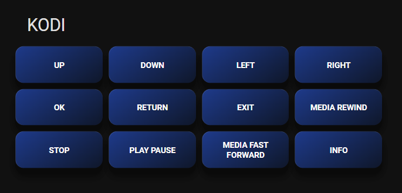

# Device Buttons Card Template

Build a dashboard remote with **one button per command** of any device controlled by your Haptique RS90.

**English** | [Français](README_FR.md)


*Example: the KODI card generated from `example_kodi.yaml`*

> 💡 **Since 1.9.0**, the built-in [Haptique RS90 dashboard](../README.md#-dashboard) does this for every device automatically and stays up to date. This template remains useful to put one device's buttons in your own dashboard.

> ℹ️ This is a **template**: Home Assistant dashboards can't run it directly. You render it once in **Developer tools → Template**, then paste the result into a card. Re-render it if the device's commands change.

---

## 📋 Prerequisites

1. ✅ **Haptique RS90 integration 1.8.0+** and **Home Assistant 2024.8+**
2. ✅ The **`Commands - <device>`** sensor of your device (created automatically)
3. ⭐ Optional: **card-mod** (from the Marketplace / HACS) for the 3D button style. Without it, the buttons work but look plain.

---

## 🚀 How to use it (4 steps)

### 1. Copy the sensor entity ID

Open your RS90 device page → **Diagnostic** → **Commands - <device>** → ⚙️ → copy the **Entity ID**.

Example: `sensor.salon_rs90_commands_kodi_osmc_vero4k`

### 2. Render the template

1. Open **Developer tools** → **Template**
2. Clear the editor and paste the contents of [`device_buttons_card.yaml`](device_buttons_card.yaml)
3. On the `` line, replace `sensor.your_rs90_commands_your_device` with your entity ID

That's the **only** thing to change: the RS90 device ID (`rs90_id`), the device ID (`rs90_device_id`) and the title are filled in automatically.

### 3. Copy the result

The **Result** panel on the right shows the finished card. Check that there's no error, then copy all of it.

### 4. Add the card

1. Open your dashboard → ✏️ **Edit** → **Add card**
2. Choose **Manual** (at the bottom of the list)
3. Paste the result and **Save**

Done: each button sends its command through `haptique_rs90.trigger_device_command`.

---

## 📝 What the template does

```yaml

type: grid
title: {{ state_attr(sensor, 'device_name') }}
columns: 4
square: false
cards:

  - type: button
    name: {{ cmd | replace('_', ' ') | tojson }}
    show_icon: false
    tap_action:
      action: perform-action
      perform_action: haptique_rs90.trigger_device_command
      data:
        rs90_id: {{ device_id(sensor) | tojson }}
        rs90_device_id: {{ state_attr(sensor, 'rs90_device_id') | tojson }}
        command_name: {{ cmd | tojson }}
    card_mod: ...

```

- `device_id(sensor)` finds the Home Assistant device ID of your RS90 by itself
- `| unique` removes commands the RS90 lists twice
- `rs90_device_id` is the stable ID of the device: the card keeps working if you rename the device in the Haptique app

A ready-made example for a KODI box: [`example_kodi.yaml`](example_kodi.yaml).

---

## 🎨 Customization

Edit the template **before** rendering it.

**Grid layout**
```yaml
columns: 3    # number of columns (default 4)
square: true  # square buttons (default false)
```

**Button colors** (in the `card_mod` block)
```yaml
--mdc-theme-primary: #1e3a8a;    # button color
--mdc-theme-secondary: #0f172a;  # gradient color
```
Red `#dc2626` / `#7f1d1d` · Green `#16a34a` / `#14532d` · Orange `#ea580c` / `#7c2d12` · Purple `#9333ea` / `#581c87`

**Button size**
```yaml
height: 50px !important;
min-height: 50px !important;
font-size: 11px !important;
```

**Only some commands**: replace `state_attr(sensor, 'commands') | unique` with your own list, e.g. `['POWER', 'UP', 'DOWN', 'OK']`.

---

## ❓ Troubleshooting

**The card shows `` or an error when I paste the template**
You pasted the template itself. Paste the **Result** from Developer tools → Template instead (step 3).

**The Result is empty or says `None`**
The sensor entity ID is wrong. Copy it again from the entity settings (step 1).

**A button does nothing**
- Check that the RS90 is **online** (Connection sensor): off its dock it goes to sleep
- Check the **Last Macro Result** sensor and the Home Assistant logs

**Buttons look plain**
Install **card-mod**, then reload the page.

**A command was added or removed on the RS90**
Render the template again and replace the card.

---

## 📚 See Also

- [README.md](../README.md) - Main integration documentation
- [Finding the IDs with Info Summary](../README.md#-finding-the-ids-the-info-summary-sensor)
- [CHANGELOG.md](../CHANGELOG.md)

---

**Questions?** Open an issue on [GitHub](https://github.com/daangel27/haptique_rs90/issues).
