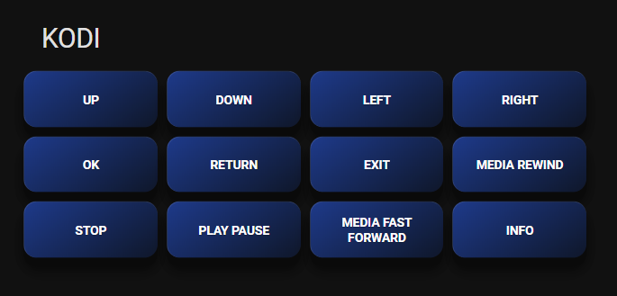

# Modèle de carte « boutons d'un appareil »

Créez une télécommande dans votre tableau de bord, avec **un bouton par commande** de n'importe quel appareil piloté par votre Haptique RS90.

[English](README.md) | **Français**


*Exemple : la carte KODI générée avec `example_kodi.yaml`*

> 💡 **Depuis la 1.9.0**, le [tableau de bord Haptique RS90](../README_FR.md#-tableau-de-bord) intégré le fait automatiquement pour chaque appareil et reste à jour. Ce modèle reste utile pour placer les boutons d'un appareil dans votre propre tableau de bord.

> ℹ️ C'est un **modèle** : les tableaux de bord de Home Assistant ne savent pas l'exécuter directement. On le calcule une fois dans **Outils de développement → Modèle**, puis on colle le résultat dans une carte. À refaire si les commandes de l'appareil changent.

---

## 📋 Prérequis

1. ✅ **Intégration Haptique RS90 1.8.0+** et **Home Assistant 2024.8+**
2. ✅ Le capteur **`Commands - <appareil>`** de votre appareil (créé automatiquement)
3. ⭐ Facultatif : **card-mod** (depuis le Marketplace / HACS) pour le style de boutons 3D. Sans lui, les boutons fonctionnent mais sont plus simples.

---

## 🚀 Mode d'emploi (4 étapes)

### 1. Copier l'entity ID du capteur

Ouvrez la page de l'appareil RS90 → **Diagnostic** → **Commands - <appareil>** → ⚙️ → copiez l'**Entity ID**.

Exemple : `sensor.salon_rs90_commands_kodi_osmc_vero4k`

### 2. Calculer le modèle

1. Ouvrez **Outils de développement** → **Modèle**
2. Videz l'éditeur et collez le contenu de [`device_buttons_card.yaml`](device_buttons_card.yaml)
3. Sur la ligne ``, remplacez `sensor.your_rs90_commands_your_device` par votre entity ID

C'est **la seule chose à modifier** : l'identifiant de la RS90 (`rs90_id`), celui de l'appareil (`rs90_device_id`) et le titre sont remplis automatiquement.

### 3. Copier le résultat

Le panneau **Résultat** à droite affiche la carte terminée. Vérifiez qu'il n'y a pas d'erreur, puis copiez-le entièrement.

### 4. Ajouter la carte

1. Ouvrez votre tableau de bord → ✏️ **Modifier** → **Ajouter une carte**
2. Choisissez **Manuel** (en bas de la liste)
3. Collez le résultat et **Enregistrez**

C'est prêt : chaque bouton envoie sa commande via `haptique_rs90.trigger_device_command`.

---

## 📝 Ce que fait le modèle

```yaml

type: grid
title: {{ state_attr(sensor, 'device_name') }}
columns: 4
square: false
cards:

  - type: button
    name: {{ cmd | replace('_', ' ') | tojson }}
    show_icon: false
    tap_action:
      action: perform-action
      perform_action: haptique_rs90.trigger_device_command
      data:
        rs90_id: {{ device_id(sensor) | tojson }}
        rs90_device_id: {{ state_attr(sensor, 'rs90_device_id') | tojson }}
        command_name: {{ cmd | tojson }}
    card_mod: ...

```

- `device_id(sensor)` retrouve tout seul l'identifiant d'appareil Home Assistant de votre RS90
- `| unique` supprime les commandes que la RS90 liste en double
- `rs90_device_id` est l'identifiant stable de l'appareil : la carte continue de fonctionner si vous renommez l'appareil dans l'application Haptique

Un exemple prêt à l'emploi pour un boîtier KODI : [`example_kodi.yaml`](example_kodi.yaml).

---

## 🎨 Personnalisation

Modifiez le modèle **avant** de le calculer.

**Disposition de la grille**
```yaml
columns: 3    # nombre de colonnes (4 par défaut)
square: true  # boutons carrés (false par défaut)
```

**Couleurs des boutons** (dans le bloc `card_mod`)
```yaml
--mdc-theme-primary: #1e3a8a;    # couleur du bouton
--mdc-theme-secondary: #0f172a;  # couleur du dégradé
```
Rouge `#dc2626` / `#7f1d1d` · Vert `#16a34a` / `#14532d` · Orange `#ea580c` / `#7c2d12` · Violet `#9333ea` / `#581c87`

**Taille des boutons**
```yaml
height: 50px !important;
min-height: 50px !important;
font-size: 11px !important;
```

**Seulement certaines commandes** : remplacez `state_attr(sensor, 'commands') | unique` par votre propre liste, par exemple `['POWER', 'UP', 'DOWN', 'OK']`.

---

## ❓ Dépannage

**La carte affiche `` ou une erreur quand je colle le modèle**
Vous avez collé le modèle lui-même. Collez le **Résultat** d'Outils de développement → Modèle (étape 3).

**Le Résultat est vide ou affiche `None`**
L'entity ID du capteur est faux. Recopiez-le depuis les paramètres de l'entité (étape 1).

**Un bouton ne fait rien**
- Vérifiez que la RS90 est **en ligne** (capteur Connection) : hors de son socle, elle se met en veille
- Regardez le capteur **Last Macro Result** et les logs de Home Assistant

**Les boutons sont tout simples**
Installez **card-mod**, puis rechargez la page.

**Une commande a été ajoutée ou supprimée sur la RS90**
Recalculez le modèle et remplacez la carte.

---

## 📚 Voir aussi

- [README_FR.md](../README_FR.md) - Documentation principale de l'intégration
- [Retrouver les identifiants avec Info Summary](../README_FR.md#-retrouver-les-identifiants--le-capteur-info-summary)
- [CHANGELOG_FR.md](../CHANGELOG_FR.md)

---

**Des questions ?** Ouvrez une issue sur [GitHub](https://github.com/daangel27/haptique_rs90/issues).
